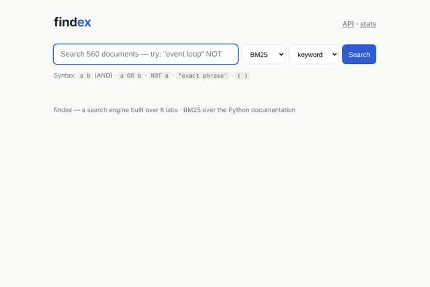
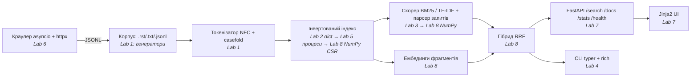

# findex

[](https://github.com/FireYaguar/lab8_Python/actions/workflows/ci.yml)

**Повнотекстовий і семантичний пошук по документації Python, побудований з нуля за 8 лабораторних: від генератора, що читає файли, до задеплоєного FastAPI-сервісу.**

**🔎 Live: https://findex-OWNER.onrender.com** · API: [`/docs`](https://findex-OWNER.onrender.com/docs) · [`/health`](https://findex-OWNER.onrender.com/health) · 🎬 [демо-відео (2:18)](docs/demo.mp4)



| Корпус | p95 пошуку | Найбільше прискорення |
|---|---|---|
| **560** документів · 15 МБ · 1,8 млн токенів · 42,6 тис. термінів | **95 мс** (10 одночасних клієнтів, 4 воркери, локально) | **49×** завантаження індексу (890 → 18 мс), NumPy-скорер **до 12,7×** |

---

## Що вміє

- **Мова запитів**: `python AND (async OR await) NOT java "event loop"` (AND/OR/NOT, дужки, фрази).
- **Рейтинг** BM25 або TF-IDF, векторизований на NumPy; **семантичний** режим (ембединги фрагментів, косинусна близькість) і **гібрид** через Reciprocal Rank Fusion.
- **CLI** `findex index | crawl | embed | search | stats | serve`, **HTTP API** з OpenAPI на `/docs` і **вебсторінка** зі сніпетами та підсвіткою.
- **Async-краулер** з `robots.txt`, лімітами на хост, повторами й backoff.
- Типи (pyright strict), **184 тести** (pytest, Hypothesis, pytest-benchmark; 3 повільні під маркером `slow`), покриття 93 %, CI, Docker.

## Швидкий старт

```bash
uv tool install .                                    # або: uv sync (для розробки)
./scripts/get_corpus.sh                              # документація Python з CPython -> data/
findex index data/ --out index.bin --positions       # ~2 с (процеси, усі ядра)
findex embed index.bin --out embeddings.npz          # ~3 с, вектори слів з models/wordvec.npz
findex search index.bin '"event loop" NOT thread'
findex search index.bin "turn objects into bytes" --mode hybrid
findex serve --index index.bin --embeddings embeddings.npz   # http://127.0.0.1:8000/
```

Docker: `docker build -t findex . && docker run -p 8000:8000 findex` (корпус, індекс і ембединги будуються всередині образу).

## Як влаштовано



| Шар | Файли | Лаба |
|---|---|---|
| Корпус, токенізатор | `corpus.py`, `tokenize.py` | 1 |
| Індекс, Boolean-merge, збереження | `index.py`, `boolean.py`, `store.py`, `arrays.py` | 2, 8 |
| Об'єктна модель `Index`, парсер, BM25/TF-IDF, сніпети | `index.py`, `query.py`, `scoring.py`, `search.py` | 3, 8 |
| CLI, пакування, тести, CI | `cli.py`, `pyproject.toml`, `tests/`, `.github/` | 4 |
| Паралельна збірка | `parallel.py` | 5 |
| Краулер | `crawler/` | 6 |
| Веб, Docker | `web/`, `Dockerfile`, `render.yaml` | 7 |
| Семантика, гібрид | `semantic.py` | 8 |

Детальні звіти Лаб 1–7 зібрані в [docs/LABS.md](docs/LABS.md).

---

## Лабораторна 8 — швидше, потім розумніше

### 1. Профіль до будь-яких правок

Інструменти: `cProfile` (які функції), `py-spy` (вибірковий, flame graph), Scalene (Python- чи нативний час по рядках). Скрипти: `scripts/lab08_profile_search.py` (50 × запит із трьох термінів `python async queue`), `scripts/lab08_profile_index.py`, файли `.prof` лежать у `docs/profiles/`.

Flame graphs: [пошук до](docs/flame_search_before.svg) · [пошук після](docs/flame_search_after.svg) · [збірка до](docs/flame_index_before.svg) · [збірка після](docs/flame_index_after.svg)

**Три гарячі місця, записані до правок:**

| # | Де | Скільки | Python чи нативний (Scalene) | Гіпотеза |
|---|---|---|---|---|
| 1 | `search` → `snippet` → `iter_spans`: щоб знайти терміни для сніпета, **кожен документ топ-10 токенізується повністю** | 11,55 з 11,67 с усього `search` (50 запитів під cProfile) — **99 %** | рядок `yield tok, m.start(), m.end()` — переважно **Python** (генератор на кожен з тисяч токенів); `casefold`/`normalize`/`translate` — нативні | шукати лише терміни запиту одним регулярним виразом, щоб цикл був у C |
| 2 | `findex search` / старт сервісу → `pickle.load` індексу | `_dataclass_setstate` — 1,32 з 1,57 с `pickle.load` (весь CLI — 1,99 с): **332 тис. викликів** | **Python**: frozen+slots датаклас відновлюється через Python-рівневий `__setstate__` | зберігати постінги масивами: pickle скопіює кілька буферів замість 331 тис. об'єктів |
| 3 | `findex index` → `tokenize`/`iter_spans` | `tokenize` — 4,72 с із 9,47 с прогону під cProfile | змішаний: regex/`casefold` нативні, але `yield` на кожен токен — Python | генератор лишається (Лаба 1), але прибрати зайві проходи по тексту, а NumPy-масиви будувати одразу з кортежів воркерів, без 331 тис. `Posting` |

Сам скорер BM25 (тема лаби) у профілі **не** гарячий: 0,05–0,6 мс на запит. Його я векторизував, як вимагає лаба, але головний виграш у сервісі дали пункти 1–2.

**Результат** (`scripts/lab08_baseline.py`, медіана):

| Що | До | Після | Прискорення | Що змінилось |
|---|---|---|---|---|
| завантаження `index.bin` | 890 мс | **18 мс** | **49×** | постінги — NumPy CSR-масиви; `Posting` створюються ліниво |
| пошук `python async queue` (від запиту до сніпетів) | 76 мс | **25 мс** | 3,0× | сніпети: один `re.finditer` по термінах замість повної токенізації; `str.replace` замість `str.translate` (ще один гарячий рядок, знайдений лише в профілі «після») |
| збірка індексу (serial, з позиціями) | 2,73 с | **1,71 с** | 1,6× | `merge` пише одразу в масиви; `str.replace` у токенізаторі |

Після правок перше місце в профілі пошуку все одно займає `snippet` (~2,5 мс на документ): це вже регулярний вираз у C по сторінках на 100–300 КБ. Наступний крок — зберігати зсуви входжень в індексі, щоб не читати файли.

### 2. NumPy-скорер

Постінги зберігаються в **CSR-розкладці** (`src/findex/arrays.py`): `doc_ids: int32[P]`, `tfs: int32[P]`, `offsets: int64[T+1]`, позиції — окремий `int32` масив; довжини документів — один `int32` масив `doc_len_array`. Для терміна береться **зріз-view**, без копії. BM25 для всіх документів терміна — це один вираз:

```python
dl = index.doc_len_array[doc_ids]  # fancy indexing
norm = k1 * (1 - b + b * dl / avg_len)
scores[doc_ids] += idf * tfs * (k1 + 1) / (tfs + norm)  # ufuncs + scatter-add
top = np.argpartition(cand, -k)[-k:]  # O(n) замість сортування
```

**Порядок результатів збігається з Лабою 3 до біта.** Формула й порядок операцій ті самі, тож float-и ідентичні. Нічиї розв'язуються так само, як у `heapq.nlargest` Лаби 3 (за зростанням `doc_id`): після `argpartition` беруться всі, хто дорівнює k-му, і сортуються `lexsort`. Перевіряють це тести `tests/test_numpy_scoring.py`: параметризовані запити, **Hypothesis з навмисними нічиїми** і повний корпус (`slow`).

Скорер окремо (match закешований, без сніпетів; `scripts/lab08_scorer_bench.py`, найкращий із 5×20 запусків):

| Запит | Збіглося документів | Постінгів | Скорер Лаби 3 (мс) | NumPy (мс) | Прискорення |
|---|---|---|---|---|---|
| частий терм `the` | 552 | 552 | 0.650 | 0.051 | **12.7×** |
| рідкісний терм `winsound` | 5 | 5 | 0.007 | 0.016 | **0.4×** (повільніше) |
| 3 терми `python OR async OR queue` | 475 | 568 | 0.585 | 0.079 | **7.4×** |
| 3 терми `python async queue` (AND) | 13 | 568 | 0.056 | 0.064 | 0.9× |

**Де виграш і де ні.** На довгому списку постінгів Python-цикл Лаби 3 робить на кожен постінг виклик методу, два пошуки в словниках і кілька boxed float. NumPy проходить той самий масив одним C-циклом, звідси 12,7×. На **рідкісному** термі (5 постінгів) роботи майже немає, і перемагають накладні витрати: створити `np.zeros(560)`, зробити зрізи, викликати ufunc-и, `argpartition`, `lexsort` — ~15 мкс сталої ціни проти 7 мкс на весь Python-цикл. У запиті **AND** NumPy так само рахує всі 568 постінгів, а Python пропускає ті, яких немає серед 13 збігів (`if doc_id in wanted`), тож роботи в нього менше. Корпус на 560 документів малий для NumPy: на мільйоні документів різниця росла б разом з довжиною списків. У CI тест `test_numpy_scorer_stays_faster_than_lab3` падає, якщо NumPy-скорер на довгому списку стане менш ніж утричі швидшим. `pytest-benchmark` на `search` і `build_index` пише числа в лог CI і в artifact `benchmark.json`.

### 3. Семантичний і гібридний пошук

```bash
findex embed index.bin --out embeddings.npz                       # 9 338 фрагментів × 300, ~3 с
findex search index.bin "isolated sandbox with its own installed packages" --mode semantic
curl "localhost:8000/search?q=...&mode=hybrid"                     # і перемикач на сторінці
```

- **Фрагменти** по 200 токенів; документ отримує бал свого **найкращого фрагмента**. Фрагменти лежать підряд за документом, тож це сегментний `np.maximum.reduceat`.
- **Схожість**: усі рядки `E` нормовані, тож `E @ q` — це косинуси всіх 9 338 фрагментів одним матрично-векторним добутком (~1 мс).
- **Гібрид**: `score(d) = Σ 1/(60 + rank_i(d))` по рейтингу BM25 (глибина 100) і семантичному. Нормалізувати бали не треба.
- **Модель.** У середовищі, де робилась лаба, Hugging Face був недоступний (мережа пропускає лише PyPI і GitHub), тож `all-MiniLM-L6-v2` завантажити не вдалось. Натомість узяв **попередньо навчені 300-вимірні вектори слів** зі spaCy `en_core_web_md` (реліз на GitHub, ліцензія MIT). `scripts/export_wordvec.py` експортує їх у `models/wordvec.npz` (7,7 МБ, 302 тис. слів), тож під час роботи потрібен лише NumPy. Ембединг тексту — це IDF-зважене середнє векторів слів плюс постобробка SIF: віднімаються середній вектор корпусу і перша головна компонента. Без SIF усі тексти мали косинус ~0,82 між собою. Це слабша модель, ніж трансформер, бо порядку слів вона не бачить, і таблиця нижче це показує.

**precision@5** (`scripts/lab08_eval.py`): 10 запитів Лаби 3 з тією самою розміткою плюс **5 перефразованих**. Їх я розмітив до запуску, і в них свідомо немає ключових слів релевантних сторінок (назв модулів, слів із заголовків). «max» — найкраще досяжне P@5, коли релевантних документів менше п'яти.

| Запит | вид | max | keyword (BM25) | semantic | hybrid (RRF) |
|---|---|---|---|---|---|
| `"event loop"` | оригінал | 1.0 | 1.0 | 0.4 | 0.6 |
| `"regular expression"` | оригінал | 0.4 | 0.4 | 0.2 | 0.4 |
| `unicode normalization` | оригінал | 0.4 | 0.4 | 0.0 | 0.2 |
| `"garbage collector"` | оригінал | 0.8 | 0.6 | 0.4 | 0.4 |
| `"context manager"` | оригінал | 0.6 | 0.2 | 0.4 | 0.2 |
| `thread lock` | оригінал | 0.6 | 0.4 | 0.2 | 0.4 |
| `json decode` | оригінал | 0.2 | 0.2 | 0.2 | 0.2 |
| `pickle unpickling security` | оригінал | 0.8 | 0.2 | 0.6 | 0.4 |
| `decorator wraps` | оригінал | 0.2 | 0.2 | 0.0 | 0.2 |
| `"virtual environment"` | оригінал | 0.8 | 0.6 | 0.8 | 0.8 |
| `run many jobs at once on all cores` | перефраз | 1.0 | 0.2 | 0.2 | 0.2 |
| `turn objects into bytes and restore them later` | перефраз | 1.0 | 0.0 | 0.2 | 0.0 |
| `spot textual patterns with wildcards` | перефраз | 0.8 | 0.0 | 0.0 | 0.0 |
| `isolated sandbox with its own installed packages` | перефраз | 0.8 | 0.0 | 0.4 | 0.4 |
| `wait for many network operations without stalling` | перефраз | 1.0 | 0.0 | 0.0 | 0.0 |
| **середнє, 10 оригінальних** | | 0.58 | **0.42** | 0.32 | 0.38 |
| **середнє, 5 перефразованих** | | 0.92 | 0.04 | **0.16** | 0.12 |
| **середнє, усі 15** | | 0.69 | 0.29 | 0.27 | 0.29 |

**Що з цього видно.** На запитах тими самими словами, що й у документах, виграє **BM25** (0,42): точні терміни, назви модулів, фрази на кшталт `"event loop"`, де семантика розмиває. На **перефразованих** BM25 майже нуль (0,04): неявний AND вимагає всіх слів, і знаходяться випадкові довгі сторінки, де вони просто трапляються. Семантика вчетверо краща (0,16), бо знаходить `pickle.rst` на «turn objects into bytes» і `venv` на «isolated sandbox», не маючи спільних ключових слів. Вона ж виграла на двох оригінальних запитах (`"context manager"`, `pickle … security`), де BM25 тягнув сторінки з купою згадок. **Гібрид** ніде не найгірший і в середньому дорівнює BM25 (0,29), але й ніде не найкращий: RRF рахує обидва рейтинги рівноправними, і слабкий рейтинг тягне сильний донизу. Головне обмеження — модель. Середнє векторів слів не бачить порядку й контексту («restore» поруч із «objects» для неї те саме, що й деінде), тож на перефразах 0,16 проти стелі 0,92. Справжній sentence-transformer (MiniLM) якраз для цього навчений, і заміна моделі — перший крок далі: `Embedder` ізольований в одному класі. Розмітка моя, а 15 запитів — мала й шумна вибірка: різниця в 0,04 тут нічого не означає, а 0,04 → 0,16 на перефразах — означає.

### 4. Навантаження після Лаби 8

`oha -z 15s "…/search?q=python"`, та сама машина (2 ядра), що й у Лабі 7:

| Ціль | Concurrency | RPS | p50 (мс) | p95 (мс) | p99 (мс) |
|---|---|---|---|---|---|
| Лаба 7: 1 воркер, `def` | 50 | 53.0 | 955 | 1349 | 1867 |
| **Лаба 8: 1 воркер, `def`** | 50 | **98.1** | 517 | 682 | 830 |
| Лаба 7: 4 воркери | 50 | 117.7 | 413 | 698 | 820 |
| **Лаба 8: 4 воркери** | 50 | **231.9** | 213 | 479 | 600 |
| Лаба 8: 4 воркери | 10 | 228.2 | 36 | **95** | 121 |
| Лаба 8: 4 воркери, `mode=hybrid` (`turn objects into bytes`) | 10 | 55.3 | 176 | 256 | 327 |
| deployed (Render free) | 20 | _заповнити після деплою v1.0.0_ | | | |

Пропускна здатність подвоїлась, бо швидшими стали сніпети, а не BM25. Гібрид повільніший: на кожен запит два рейтинги і сніпети для слів, що трапляються в сотнях документів.

---

## Зведені виміри: Лаби 1–8

**Лаба 1 — генератори проти списків** (повний корпус, `tracemalloc`):

| Версія | Пік пам'яті | Час |
|---|---|---|
| eager (списки) | 109,3 MiB | 6,99 с |
| lazy (генератори) | **6,8 MiB** | 6,72 с |

**Лаба 2 — представлення постінгів** (331 826 постінгів):

| Представлення | Пік (збірка) | Утримано | Файл (pickle) | Завантаження |
|---|---|---|---|---|
| `list[Posting]`, звичайний `@dataclass` | 38,7 MiB | 36,6 MiB | 6,5 MiB | 0,17 с |
| `list[Posting]`, `slots=True` | 26,3 MiB | 23,9 MiB | 5,3 MiB | 0,71 с |
| пари `array('I')` | **17,6 MiB** | **15,1 MiB** | **4,4 MiB** | **0,04 с** |
| _Лаба 8: NumPy CSR (+ позиції)_ | | | 12,8 MiB | **0,018 с** |

**Лаба 2 — merge проти set і формати збереження:** на двох довгих списках set швидший у ~3 рази (48 проти 18 мкс, AND), коли один зі списків короткий — швидший merge (0,1 проти 4,4 мкс). JSON без позицій менший (3,3 проти 5,6 MiB) і швидше вантажиться (0,49 проти 0,94 с), ніж pickle об'єктів `Posting`.

**Лаба 3 — рейтинг:** 20-те входження додає до BM25 0,9 % від першого (до TF-IDF — стільки ж, скільки перше); короткий документ (26 токенів) отримує в BM25 у 4,8 раза вищий бал, ніж довгий (15 052). P@5 на 10 запитах: TF-IDF **0,34**, BM25 **0,42**.

**Лаба 4 — якість:** pyright strict 0 помилок; покриття 97 % → (Лаба 8) **93 %**, 184 тести; CI: ruff, pyright, pytest, benchmarks, wheel; релізи з wheel для тегів `v*` створює `release.yml` автоматично.

**Лаба 5 — паралельна збірка** (2 ядра; медіана з 3; serial = 1,78 с):

| Виконавець | Воркери | Wall (с) | CPU (с) | Прискорення |
|---|---|---|---|---|
| threads (GIL) | 2 / 4 / 8 | 1,74 / 1,73 / 1,81 | ≈ wall | ~1,0× |
| **processes** | **2** | **1,20** | 1,89 | **1,48×** |
| processes | 8 | 1,53 | 2,66 | 1,17× |
| threads, 3.13t (без GIL) | 2 | 1,86 | 2,78 | 0,96× (serial 3.13t: 2,22 с) |

Гонитва на 3.13t: спільний `Counter` під 4 потоками губив 12–15 тис. оновлень, під GIL — 0.

**Лаба 6 — краулер** (300 сторінок, локальне дзеркало з затримкою ~0,1 с):

| Concurrency | Per host | Wall (с) | Сторінок/с | Повтори 429 |
|---|---|---|---|---|
| 1 | 1 | 33,96 | 8,8 | 0 |
| 5 | 5 | 6,72 | 44,6 | 0 |
| **20** | 20 | **3,81** | **78,7** | 26 |
| 20 | 2 | 16,72 | 17,9 | 0 |

**Лаба 7 — `def` проти `async def`:** однакова пропускна здатність (GIL), але під `async def /search` p99 сторонній `/health` — ~410 мс проти ~130 мс з `def`. Таблиця `oha` — у розділі 4 вище.

**Лаба 8:** див. розділи 1–4 вище.

---

## Обмеження (чесно)

- **Корпус малий**: 560 документів / 15 МБ. На такому розмірі NumPy і процеси дають скромний виграш, а виміри зроблено на машині з 2 ядрами.
- **Семантика — на векторах слів**, а не на трансформері (MiniLM був недоступний): на перефразах P@5 лише 0,16. Гібрид за якістю дорівнює BM25.
- **Краулер обходив локальне дзеркало**, а не живий сайт (з середовища розробки зовнішні сайти були недоступні). Код той самий, `robots.txt` і ліміти виконуються.
- **Сніпети перечитують файли з диска** при кожному пошуку, тож для сторінок із краулера (в індексі лише URL) сніпета й тексту документа немає.
- **pickle** — лише для власних файлів індексу (див. Лабу 2); індекс повністю в пам'яті, без `mmap`; оновлення індексу — тільки повна перебудова.
- **Неявний AND** у keyword-режимі: довгі природні запити краще шукати в `hybrid` чи `semantic`.
- Безкоштовний Render засинає без трафіку: перший запит після паузи йде ~30–60 с.

## Демо-відео

🎬 [docs/demo.mp4](docs/demo.mp4) (2 хв 18 с, без звуку, з підписами на екрані; записано скриптом `scripts/make_demo_video.py`: Playwright керує справжнім сервісом у Chrome). Зміст: (1) пошук у вебінтерфейсі з фразою й `NOT`, сторінки, перегляд документа; (2) той самий перефразований запит у `keyword`, `semantic` і `hybrid`; (3) OpenAPI-схема, JSON від `/search` і `/health`; (4) flame graph «до/після» і таблиця NumPy; (5) один баг, який чогось навчив: гонитва на спільному `Counter` у Python 3.13t (Лаба 5).

## Ліцензії даних

Корпус — документація CPython (PSF License). Вектори слів — spaCy `en_core_web_md` (MIT).
